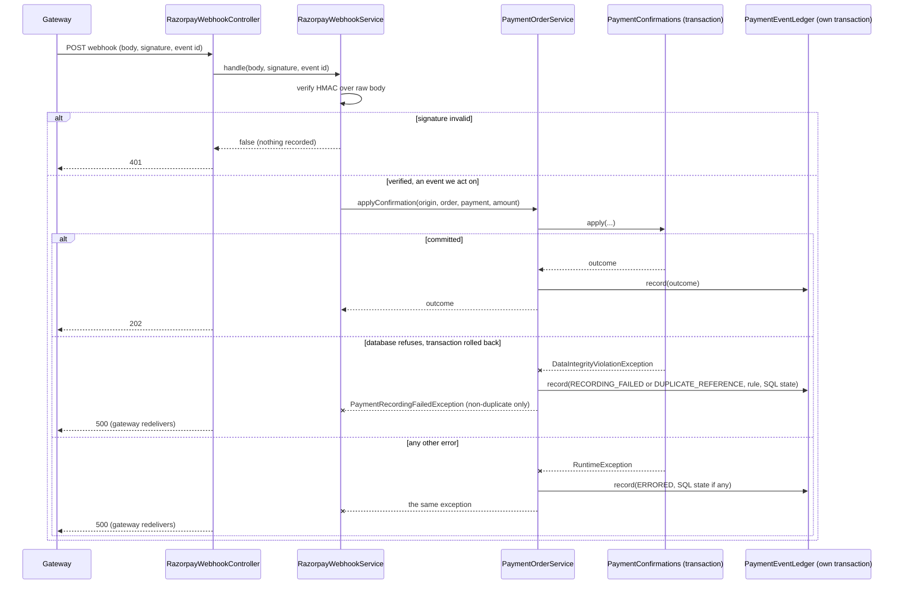

## Why

A gateway payment confirmation leaves no durable trace unless it succeeds. When the database
refuses to record a captured payment (`payment-confirmation-catch-all-integrity-mapping`), the
confirmation transaction rolls back, the order stays `CREATED`, the agreement stays unpaid, and
the only evidence is one ERROR line per attempt. A refused duplicate reference leaves one WARN.
Working out what the gateway sent and what we did with it means reading the server log beside
the gateway dashboard.

This is the first of three changes split out of the `payment-recording-failure-staff-alert`
register row. The other two, a staff alert and a staff console panel, both need a durable
record to read: the alert sweep reads rows, and a failed confirmation writes none today.

## What Changes

- A new table, `payment_event`, records **every payment confirmation attempt**: every call
  that reaches the single confirmation path (`PaymentOrderService.applyConfirmation`) from the
  gateway webhook, the browser checkout callback, or the reconciliation job.
- Each row records: where the attempt came from, the event id presented with it and the event
  type (webhook only), the gateway order id, the gateway payment id, the reported amount and
  currency, and what happened. For an attempt the database refused, it also records the
  refused rule's name and the SQL state.
- **A row is one distinct attempt, with a count.** An attempt identical to an earlier one in
  everything but its time and presented event id raises that row's count and moves its
  last-received time; it does not add a row. So a stuck order re-read every five minutes, or a
  replayed webhook, cannot grow the table (decided 2026-10-11 after review; design D9).
- The outcome is one of the six existing confirmation outcomes, `RECORDING_FAILED` for a
  database refusal that is not a duplicate, or `ERRORED` for a confirmation that ended in any
  other error.
- The row is written **outside** the confirmation transaction, so it survives that
  transaction's rollback.
- A ledger write that fails never changes the answer: a confirmed payment stays confirmed, and
  a recording failure still fails the webhook so the gateway delivers it again.
- The webhook controller reads the `X-Razorpay-Event-Id` header and passes it down. The header
  is **not covered by the webhook signature**, so it is stored as a label only, never used to
  decide anything, and dropped when it is not a short plain token.
- **Not recorded**, because the data is unverified or no confirmation was attempted: a webhook
  whose signature fails (`401`), a verified body that cannot be parsed, an event type we do not
  act on, and an authoritative read where the gateway reports the order unpaid or without a
  captured payment.
- **Not stored: the raw payload.** It carries payer PII (email, phone, UPI id or card last
  four) and can be re-read from the gateway by payment id.
- **Not stored: the HTTP status answered.** The register row listed it. It is fixed by the
  source and the outcome, so a stored copy would be a second home for the controllers' mapping
  and would drift from it. Readers derive it; design D8 has the mapping.

**Not in this change** (each is its own later CR that reads this ledger):

- The staff alert for a recording failure or a refused duplicate.
- The staff console panel "Payments needing attention", including retry and record-by-hand.
- Any reader of the ledger at all: no endpoint, no screen, no job reads it here.
- Staff confirm and waive (`PaymentService`). They are not gateway confirmations and write no
  payment order.
- Deleting or expiring ledger rows.

## Capabilities

### New Capabilities

- `payment-event-ledger`: the durable record of every gateway payment confirmation attempt,
  what it carried and what the system did with it.

### Modified Capabilities

None. `payment-processing` is unchanged: the outcomes, the webhook's answers and the
no-payment-id rule for the raised failure and its log line all stand. The ledger is a database
record, not a log line or an error body. A new capability with only added requirements also
keeps this change clear of the `payment-processing` delta the active `razorpay-payment` change
holds.

## Impact

**Code (backend only, `signing` module, no SPA diff):**

- `db/migration/V29__payment_event.sql`: the table and two indexes.
- `signing/payment/PaymentEvent.java`, `PaymentEventOutcome.java`, `PaymentEventLedger.java`,
  `PaymentEventOrigin.java`: new, package-private. No JPA entity and no repository: nothing
  reads the table here.
- `signing/payment/PaymentOrderService.java`: `applyConfirmation` and `readAuthoritatively`
  take the attempt's origin; `applyConfirmation` records the attempt on every path.
- `signing/payment/RazorpayWebhookService.java`: `handle` takes the event id; `apply` passes it
  and the event type on.
- `signing/payment/PaymentReconciliationJob.java`: passes its origin.
- `signing/api/RazorpayWebhookController.java`: reads `X-Razorpay-Event-Id`.
- `docs/ARCHITECTURE.md`: the ledger, and what it deliberately leaves out.
- `docs/ROADMAP.md`: the `payment-recording-failure-staff-alert` row is trimmed to its two
  remaining parts.

**Signing-status FSM:** untouched. No `SignatureStatus` transition is read or written. Payment
state (`UNPAID`/`PAID`/`WAIVED`) and payment order status are not changed either: the ledger
observes the confirmation path and never feeds back into it.

**Async webhook flow:** the payment webhook gains one write after the confirmation, on the same
request thread. Nothing blocks on an external call. Verification, the answers and the
confirmation itself are unchanged.

**PII / security review:**

- **Aadhaar / OTP / VID / KYC:** none read, written, logged or transmitted.
- **Party PII:** none. The ledger holds gateway identifiers and an amount, the same categories
  `payment_order` already holds and the privacy policy already describes ("the amount, the
  payment gateway's order and payment references"). No policy change.
- **Payer PII:** deliberately excluded. Nothing is taken from the webhook body beyond the
  fields the confirmation already reads (event type, order id, payment id, amount, currency).
- **Untrusted input:** nothing is recorded before the webhook signature verifies. The event id
  header is outside the signature, so it is format-checked, length-bounded and never acted on.
  Every stored string is length-bounded before the write, so an oversized gateway value cannot
  make the ledger write fail the way it made the payment write fail.
- **Logging:** no new log line carries a payment id or an amount. A ledger write that fails
  logs the outcome token only.
- **Secrets:** none introduced or moved. Sandbox and dummy data only is preserved.
