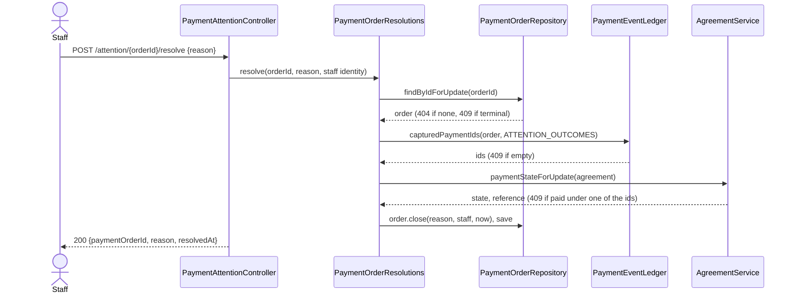

## Context

Slice 1 of 3 of the payments-needing-attention work, cut from
`payments-needing-attention-panel` in its round-1 review (2026-10-11). That change's D1, D3 and D8
are carried here, trimmed of record by hand, with the review's decisions applied. Slice 2 is the
panel (list, retry, the resolve button); record by hand is parked (`payment-record-by-hand`).

Facts from the code that shape this design:

- A payment order becomes `PAID` only in `PaymentConfirmations.apply`. Nothing else ends an
  order's life: `FAILED` is declared and guarded but never written in production
  (`markFailed` has no caller), and `EXPIRED` is written by `reusableOrder` and by reconciliation
  for an order the gateway does not report paid.
- `PaymentReconciliationJob` scans `CREATED` orders only and expires one only on `UNKNOWN_ORDER`.
  A mismatch, a reused id or a recording failure leaves the order `CREATED` and re-read for ever.
- `PaymentOrderStatus.settled()` (`PAID` only) is read by `apply` (idempotency), by the guards in
  `markPaid` / `markFailed` / `markExpired`, by `reusableOrder` and `startCheckout` ("already
  paid"), and by `stampQuote` (which quote is shown).
- `PaymentOrderRepository` has no lock-by-id finder (only by provider order id).
  `payment_event` has one writer, `PaymentEventLedger`, and no read method; its only reader is the
  native join in `findUnrecordedSince`, which hand-types `o.status <> 'PAID'`.
- `PaymentEventOutcome.of(ConfirmationOutcome)` is an exhaustive switch: a new confirmation
  outcome fails the build there until it is mapped.
- `progress()` and `toSession()` put `order.status().name()` on customer endpoints. The frontend
  types it as a string and only tests it for null (`AgreementStatus.vue`).
- `reusableOrder` runs outside any transaction: it loads the latest order, calls `markExpired`
  and saves. A concurrent write to that row makes the save an optimistic-lock failure, which
  reaches the customer as a server error. This is already true today for a webhook that marks the
  order paid at that moment.
- `SecurityConfig` pins each staff route by exact method and path. CSRF verification runs before
  authentication, so an unsafe request without a token gets the CSRF 403 before any 401
  (`CsrfProtectionIntegrationTest.anAnonymousStaffCallWithoutATokenGetsTheCsrfRefusalAndWithATokenGets401`).
- `payment_order.status` is `VARCHAR(16)` with no check on its values; `payment_event.outcome`
  has none either. The enums are the one home for those lists.
- `AgreementService.recordPayment` (the agreement-keyed staff confirm) locks the agreement row
  only, never an order.

## Goals / Non-Goals

**Goals:**

- A stuck order has an exit, and takes it only by a deliberate, attributed staff action.
- A closed order is inert everywhere: confirmation, reconciliation, expiry, the alert sweep.
- Each list (terminal statuses, qualifying outcomes) has one home.
- The resolve endpoint is complete enough for slice 2's button to call unchanged.

**Non-Goals:**

- The panel screen, the list read, retry, the dashboard and alert links (slice 2).
- Record by hand (`payment-record-by-hand`), and the Razorpay client timeout (separate fix).
- Refunding. Staff refund in the gateway dashboard and then mark the order resolved.
- Reopening a closed order. There is no such action.
- Fixing `checkout-ignores-agreement-paid-state` (its own register row).

## Decisions

### D1. A new terminal status, `CLOSED`, separate from `settled()`

`PaymentOrderStatus` gains `CLOSED` and a second predicate, `terminal()` (`PAID` or `CLOSED`).
`settled()` keeps meaning `PAID`: "a confirmation was applied" is what checkout reuse and the
frozen-quote read ask, and a refunded order must not answer yes to either.

| Site | Reads today | After |
|---|---|---|
| `PaymentOrder.markFailed` / `markExpired` | `!settled()` | `!terminal()` - a closed order never moves |
| `PaymentOrder.markPaid` | `settled()` returns | `terminal()` returns |
| `PaymentConfirmations.apply` | `settled()` -> `ALREADY_CONFIRMED` | unchanged, plus `CLOSED` -> `ORDER_CLOSED` (D3) |
| `reusableOrder`, `startCheckout`, `stampQuote` | `settled()` / `outstanding()` | unchanged: `CLOSED` is neither, so a new order is legal and a fresh quote is shown, exactly as for `EXPIRED` |
| `PaymentReconciliationJob` | scans `CREATED` | unchanged: a closed order is out of the scan by construction |
| `findUnrecordedSince` | `o.status <> 'PAID'` | `o.status NOT IN (:terminalStatuses)`, bound by the caller from `PaymentOrderStatus` (D7) |

`PaymentOrder.close(reason, actor, at)` is the only writer of `CLOSED`. It refuses a terminal
order by throwing, unlike the `mark*` methods which ignore one: a redelivery may legitimately try
to re-apply a transition, but a second close is a caller error and must not pass silently.

The one-outstanding-order-per-agreement partial unique index covers `CREATED` only, so closing an
order frees the agreement for a new one with no index change.

*Alternative considered:* a separate "handled" table that leaves the order `CREATED`. Rejected in
the parent change: the endless re-read and the held batch slot remain.

### D2. `V31`: who, when, why, on the order row - and no separate audit table

`V31__payment_order_close.sql` adds to `payment_order`:

- `resolved_by UUID REFERENCES identity (id)`, `resolved_at TIMESTAMPTZ`,
  `closed_reason VARCHAR(24)`, all nullable;
- one named check, `ck_payment_order_closed`:

  ```sql
  CHECK ((status = 'CLOSED') = (closed_reason IS NOT NULL)
     AND (resolved_by IS NULL) = (resolved_at IS NULL)
     AND (status <> 'CLOSED' OR resolved_by IS NOT NULL))
  ```

The foreign key keeps the default delete action: an identity that closed an order cannot be
deleted, and nothing cascades. The actor and time are a pair on every row, and required on a
closed one; they are not forbidden on a row that is not closed, so the parked record by hand (a
`PAID` order with an actor) needs no loosening migration. `resolved_at` is stored truncated to
microseconds, which is what the column holds, so the response and the row agree.
The reason's values are not listed in SQL: `PaymentOrderCloseReason` (`REFUNDED`,
`RECORDED_ELSEWHERE`) is their one home, as `V29` does for the ledger's lists.

**Audit - decided: the three columns are the record; no audit table.** The review asked whether
three mutable columns are enough. They are, because nothing can rewrite them:

- `close` is the only method that sets them and it refuses a terminal order; every other mutator
  ignores a terminal order (D1). No code path writes a closed row again.
- The check makes a half-written close impossible.
- A separate append-only table would be exactly as editable by someone with database access, and
  with no reopen there is never a second event per order for it to hold.
- It follows the existing precedent for a staff payment act (`agreement.payment_actor_identity_id`,
  `V16`).

The close also writes one `INFO` log line: payment order id, reason, staff identity id. No
gateway id, no amount, no agreement id.

Revisit if a reopen is ever added - that is the point at which one row can no longer hold the
history.

### D3. A confirmation for a closed order is its own outcome

`ConfirmationOutcome` and `PaymentEventOutcome` gain `ORDER_CLOSED`, and `PaymentEventOutcome.of`
maps it. `apply` returns it after the unknown-order check and before the settled check, the
amount check and any write. Every caller treats it as it treats any returned non-`CONFIRMED`
outcome:

| Caller | On `ORDER_CLOSED` |
|---|---|
| Webhook | answers `200`; the gateway stops redelivering |
| Browser callback | returns payment progress, as always |
| Reconciliation | cannot occur from its own scan; if a close lands mid-run it takes the existing "handled, not our business" branch |

`applyConfirmation` records the attempt in the ledger after `apply` returns, as it does for every
returned outcome; no change there.

*Alternative considered:* treat `CLOSED` as settled and return `ALREADY_CONFIRMED`. Rejected: the
ledger would say a confirmation had been applied to an order that was refunded.

### D4. Which orders may be resolved, with one home for the outcome set

An order may be resolved when it is not terminal and the ledger holds, for its provider order id,
a row with a payment id and an outcome in the **attention set**: `RECORDING_FAILED`,
`DUPLICATE_REFERENCE`, `AMOUNT_MISMATCH`, `ERRORED`.

The set is derived beside the alert's, in `PaymentOrderQueryAdapter`:
`ATTENTION_OUTCOMES = UNRECORDED_OUTCOMES.keySet() + ERRORED`. The alert keeps reading
`UNRECORDED_OUTCOMES`; slice 2's list will read `ATTENTION_OUTCOMES`. The four names are typed
nowhere else.

The ledger gets its first read, on the class that already owns the table:
`PaymentEventLedger.capturedPaymentIds(providerOrderId, outcomes)` returns the distinct payment
ids of the matching rows. Empty means "not resolvable". It is a plain read on the caller's
transaction - not the writer's own-transaction template, which would take a second connection
while the order row is locked. It is the minimum this slice needs; slice 2 adds the history read.

The ledger is best-effort, so an order whose attempt row was never written cannot be resolved
through the API. The runbook names the fallback.

**"Paid under that captured payment"** when the rows name more than one payment id: resolve is
refused if the agreement is `PAID` and its recorded reference equals **any** of them, compared
with `PaymentConfirmation.normalizeReference` on both sides. A waived or unpaid agreement, or one
paid under any other reference, does not block.

### D5. Resolve is one transaction: lock the order, then the agreement



- New `PaymentOrderRepository.findByIdForUpdate` (`PESSIMISTIC_WRITE`). It locks the same row
  `apply` locks by provider order id, so a confirmation and a close serialize: whichever commits
  first, the other sees a terminal order (`ORDER_CLOSED`, or a 409).
- The agreement is read **under its row lock**, through a new
  `AgreementService.paymentStateForUpdate`. Without it, the agreement-keyed staff confirm could
  record this payment between the check and the commit, leaving the closed-but-paid order the
  refusal exists to prevent. Order first, then agreement: the order every payment path takes.
- `PaymentOrderResolutions` is its own bean in `signing.payment`, `public` with a public result
  record, because the controller is in `signing.api`. Same module; `ModularityTests` is unaffected.
- It calls no gateway, publishes no event and writes no ledger row.

### D6. The endpoint

`POST /api/staff/payments/attention/{paymentOrderId}/resolve`, body `{ "reason": "REFUNDED" |
"RECORDED_ELSEWHERE" }`, in a new `PaymentAttentionController` (slice 2 adds the list and retry
to it).

- `SecurityConfig`: one exact matcher, `POST /api/staff/payments/attention/*/resolve`, STAFF. The
  existing `/api/staff/payments/*/confirm` patterns have one path segment where this has two, so
  they do not swallow it.
- The actor is `@AuthenticationPrincipal`, never a body field.

| Case | Status | Problem type |
|---|---|---|
| Accepted | 200 | - |
| No CSRF token (any caller) | 403 | existing `csrf` |
| No session, valid token | 401 | - |
| Not staff, valid token | 403 | - |
| Reason missing | 400 | existing `validation` |
| Reason not one of the two names, or a number | 400 | existing `malformed-request` |
| Path id not a UUID | 400 | existing `type-mismatch` |
| Unknown order id | 404 | existing `resource-not-found` |
| Order already closed | 409 | new `payment-order-already-closed` |
| Order paid, or no qualifying ledger row | 409 | new `payment-order-not-resolvable` |
| Agreement paid under this payment | 409 | new `payment-recorded-under-this-payment` |

A second resolve of a closed order is a 409, not a silent 200: the reason might differ, and the
stored one must not look confirmed. It has its own type so slice 2's button can tell a double
click or a retried timeout (the close succeeded) from a stale list. The three new types are
`ConflictException` factories registered in `GlobalExceptionHandler` beside the existing ones,
each with constant detail text: no order id, payment id or reference.

The reason is bound by name only. Stock Jackson accepts an enum's ordinal, so `{"reason": 0}`
would close an order as refunded; the enum refuses numbers (`@JsonCreator` on the name, or
`FAIL_ON_NUMBERS_FOR_ENUMS` on this type), and the request record carries `@NotNull` and is
bound with `@Valid` so a missing reason is a 400 and never reaches the `V31` check.

### D7. The alert sweep and the bound status list

`PaymentOrderStatus` exposes its terminal values once (`terminalStatuses()`, from which
`terminal()` is defined). `PaymentOrderQueryAdapter.unrecordedPaymentsSince` binds their names
into `findUnrecordedSince`, the same way it already binds the outcomes. The sweep's own code is
untouched; `findAgreementIdsPaidSince` and `findSurplusPaidSince` filter on `PAID` and are
unaffected.

An alert already recorded for an order that is then closed is still sent: "paid or closed" is
decided when the alert is recorded, not when it is sent, as today.

`docs/DEPLOYMENT.md` holds two hand-typed copies of `status <> 'PAID'` (the stuck-order query and
the re-queue statement). Both become `NOT IN ('PAID', 'CLOSED')`. They are operator SQL, so they
cannot be bound; the runbook says where the list lives.

### D8. Customer endpoints never say `CLOSED`

`PaymentOrderStatus.customerFacing()` returns the status itself, except `CLOSED` -> `EXPIRED`.
`progress()` and `toSession()` emit `customerFacing().name()`.

`CLOSED` is a staff decision about a refund or a bookkeeping correction; the customer's question
is only "can I still pay this order", and the answer is the one `EXPIRED` already gives. It also
keeps the customer vocabulary at the four values it has today, so no frontend change is needed
now or when the UI later branches on the value. `toSession` cannot in practice receive a closed
order (it is given a reusable or a new one); it uses the same method so the rule has no second
path.

*Alternative considered:* emit `CLOSED`. Works today (the frontend only tests for null) but
publishes a staff-side state on a customer API for no customer benefit.

### D9. `reusableOrder` survives a concurrent write

`reusableOrder` catches `OptimisticLockingFailureException` on its expiring save and decides
again from a fresh read, once. After a concurrent close the fresh read is `CLOSED` (a new order
is legal); after a concurrent confirmation it is `PAID` (reported as already paid). Both are the
right answer, and the customer no longer gets a server error. This fixes the existing
webhook-versus-expiry case as well as the new one.

Reconciliation's `markExpired` has the same shape and needs nothing: its per-order catch already
turns the failure into a skipped order.

### D10. The sibling `razorpay-payment` delta

`razorpay-payment` is implemented and unarchived (five manual-verification tasks open). Its
`payment-processing` delta says a new order "MAY be created once an outstanding one has expired
or failed". That requirement is not in the baseline yet, so this change cannot `MODIFY` it, and
must not: a `MODIFIED` delta against a sibling's `ADDED` would force an archive order.

Instead: this change states the closed case in its own `ADDED` requirement, and corrects the one
sentence in the sibling's delta to "expired, failed, or been closed by staff" so the two do not
disagree when both are folded. That edit is a separate change set with its own commit. If this
change archives first, the baseline briefly holds the closed-order requirements without the
order-creation requirement beside them; that is coherent once both are folded.

**The parent, `payments-needing-attention-panel`,** still holds the text this slice was cut from:
an `ADDED` requirement of the same name, `MODIFIED` deltas for the same two blocks, and `V31`.
Archived as it stands it would abort or overwrite this change's text. It is paused and is
rewritten when it resumes; task 7.5 records in its journal exactly what that rewrite must drop
and rebase, including the panel's "resolve is permitted for every listed order" rule, which this
change's D4 contradicts.

## Risks / Trade-offs

- [Staff close an order as refunded without refunding] -> the actor and reason are stored and
  logged; a later gateway delivery is in the ledger as `ORDER_CLOSED`. No system check is
  possible without a refund integration.
- [A new capture on a closed order would be told to no one: `ORDER_CLOSED` is not in the alert
  set, and a closed order is off slice 2's list] -> accepted. An order qualifies for resolve only
  once the gateway has reported a captured payment for it, and a Razorpay order takes one
  successful payment, so later deliveries are redeliveries of the same one. The ledger still
  holds every such attempt.
- [A closed order on an agreement paid some other way lets checkout open a new order] -> the same
  exposure an `EXPIRED` order has today; `checkout-ignores-agreement-paid-state` owns it and
  already names this case.
- [Until slice 2 ships, an order whose agreement is paid under its captured payment can be
  neither closed (refused, D4) nor settled (retry is slice 2)] -> it stays as it is today:
  re-read by reconciliation, which settles it once the cause is fixed.
- [`resolved_by` has a foreign key to `identity`, so an identity that closed an order cannot be
  hard-deleted] -> intended; the same holds for `payment_actor_identity_id` and the stamp intake
  actor.
- [A new enum value the previous build cannot read] -> see Migration Plan.

## Migration Plan

1. Deploy as usual. `V31` is additive: nullable columns, and a check every existing row passes
   (none is `CLOSED`, none has a reason).
2. **Rollback** to the previous release crosses a migration, so it is the dump restore described
   under "Rolling back across a migration" in `docs/DEPLOYMENT.md`; `deploy.sh rollback` refuses
   otherwise. Any close made since the deploy is lost with it and the order returns to its
   earlier state. There is no down script, by the current decision.
3. No backfill. Existing stuck orders stay as they are until staff resolve them.

## Open Questions

None blocking. To confirm during manual testing: that a test-mode webhook redelivered for a
closed order is answered `200` and stops.
