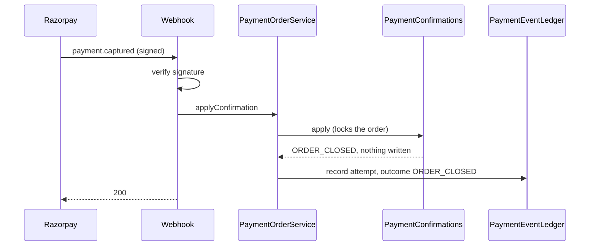

## Why

A payment order whose money was captured but could not be recorded (a recording failure, a reused
payment id, an amount mismatch, an error) has no exit. It stays `CREATED`, the reconciliation job
re-reads it from the gateway every five minutes for ever, it holds one of the job's 50 batch
slots, and once staff have refunded it or recorded the money some other way nothing in the system
can say so. This is slice 1 of 3 of the payments-needing-attention work: it gives the order a
terminal state and the one staff action that sets it, so the panel (slice 2) has something to
call.

## What Changes

- A payment order gains a terminal status, `CLOSED`, set only by a staff member marking the order
  resolved, with a reason: `REFUNDED` or `RECORDED_ELSEWHERE`.
- New endpoint `POST /api/staff/payments/attention/{paymentOrderId}/resolve`, STAFF only. API
  only: no console screen in this slice.
- Resolve is accepted only for an order that is not already paid or closed and for which the
  payment event ledger holds a captured-but-unrecorded attempt. It is refused when the agreement
  is already paid under that captured payment (that order should be settled, not closed).
- The order row records who closed it, when and why (`V31`). There is no free-text note.
- A gateway confirmation for a closed order gets its own outcome, `ORDER_CLOSED`: the webhook is
  acknowledged, the attempt is written to the ledger, and nothing else changes.
- A closed order never moves again, is never re-read by reconciliation, raises no
  unrecorded-payment alert, and does not stop the customer starting a new order.
- Customer payment endpoints never report `CLOSED`; a closed order is reported to the customer as
  `EXPIRED`, which is what it means to them (no longer payable, a new order may be started).
- Checkout no longer fails with a server error when an order is closed or paid at the same moment
  it is being expired.

Not in this change: the panel screen, retry, record by hand, the Razorpay client timeout.

## Capabilities

### New Capabilities

None.

### Modified Capabilities

- `payment-processing`: two new requirements - a staff-closed order is terminal, and the staff
  resolve action that closes one.
- `payment-event-ledger`: "Every gateway payment confirmation attempt is recorded" gains the
  outcome "order closed", and states that closing an order adds no record.
- `staff-order-alert`: "A captured payment that was refused or not recorded raises a staff alert"
  excludes an order closed by staff.

## Impact

- **Backend, `signing.payment`:** `PaymentOrderStatus`, `PaymentOrder`, `PaymentConfirmations`,
  `ConfirmationOutcome`, `PaymentEventOutcome`, `PaymentOrderRepository`, `PaymentEventLedger`
  (a first read method), `PaymentOrderQueryAdapter`, `PaymentOrderService`, and a new resolve
  service.
- **Backend, `signing.api` and root:** a new controller, one `SecurityConfig` matcher, two
  conflict problem types.
- **Backend, `signing.agreement`:** one new read of an agreement's payment state under its row
  lock.
- **Schema:** `V31`, three nullable columns and one check on `payment_order`. Additive.
- **Docs:** `docs/DEPLOYMENT.md` runbook (resolve step; two hand-typed `status <> 'PAID'`
  queries), `docs/ARCHITECTURE.md`, `docs/ROADMAP.md`.
- **Frontend:** none.
- **Sibling change:** the unarchived `razorpay-payment` delta says a new order may be created
  once one "has expired or failed". This change adds "closed" as a third case in its own
  requirement and corrects that one sentence in the sibling's delta.

### Signing-status FSM

Not touched. `SignatureStatus` and its transitions are unchanged. The state machine that changes
is the payment order's: `CREATED | FAILED | EXPIRED -> CLOSED`, terminal.

### Payment webhook path

`RazorpayWebhookService` is not edited, but what it gets back changes for one case. For a closed
order `PaymentConfirmations.apply` returns `ORDER_CLOSED` before the amount check and before any
write; the webhook answers `200` as it does for every returned outcome, so the gateway stops
redelivering, and the ledger holds one `ORDER_CLOSED` row. Signature verification, the event
filter and every other outcome are unchanged.

### PII / security review

- **Aadhaar, OTP, VID, signer PII:** none. The change reads and writes payment order rows only.
- **Secrets:** none added; no new environment variable.
- **New outbound flow:** none. Resolve calls no gateway and sends nothing.
- **Identifiers:** the resolve response carries the payment order id, the reason and the time. It
  carries no agreement id, no receipt (which is the agreement id) and no gateway id. The new log
  line carries the payment order id, the reason and the staff identity id, and no gateway id or
  amount.
- **Authorization:** STAFF role, decided in the filter chain before any lookup; CSRF applies. The
  actor is the authenticated principal, never a request field.
- **Sandbox and dummy data only:** preserved.
